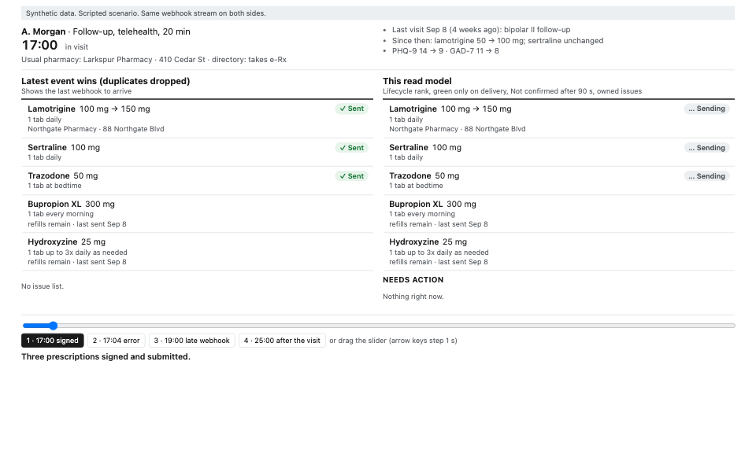

# [Project name]

By [Ahmed Sozzer](https://amsozzer.com) · [github.com/Amsozzer1](https://github.com/Amsozzer1)

[One line: what it is.]

[One short paragraph: the problem, in plain words.]



*[Caption: what's on the left, what's on the right, what to notice.]*

## Results

[Where and how this was measured: hardware, runs, seeds.]

<!-- results:headline -->
| Read model | Silently wrong at visit close (per 1,000 prescriptions) | Known failure hidden (minutes per 1,000 prescriptions) | Failed with no owner 10 min after the visit |
|---|---:|---:|---:|
| Latest event wins | 13.3 | 670.1 | no issue list |
| Latest event wins, duplicates dropped | 11.6 | 340.2 | no issue list |
| **This read model** | 0.0 | 0.0 | 0.0% |

*Seeds 0–199, 20 visits each: 8,044 synthetic prescriptions, 621 of which really failed. Fault level 10%. Pooled over all seeds.*
<!-- /results:headline -->

### What each rule contributes

<!-- results:ablation -->
| Read model | Silently wrong at visit close (per 1,000 prescriptions) | Known failure hidden (minutes per 1,000 prescriptions) | Failed with no owner 10 min after the visit |
|---|---:|---:|---:|
| Latest event wins | 13.3 | 670.1 | no issue list |
| Latest event wins, duplicates dropped | 11.6 | 340.2 | no issue list |
| **This read model** | 0.0 | 0.0 | 0.0% |
| Duplicates dropped + green only on delivery | 0.0 | 340.2 | no issue list |
| This read model without lifecycle rank | 0.0 | 340.2 | 0.0% |
| This read model without green only on delivery | 1.1 | 0.0 | 0.0% |
| This read model without "Not confirmed" after 90 s | 0.0 | 0.0 | 4.0% |
| This read model without next steps and clinic queue | 0.0 | 0.0 | no issue list |

*Seeds 0–199, 20 visits each: 8,044 synthetic prescriptions, 621 of which really failed. Fault level 10%. Pooled over all seeds.*
<!-- /results:ablation -->

Full numbers and how each was produced: [`results/numbers.md`](results/numbers.md).

## How it works

[3–6 bullets or a short diagram.]

## Run it

```sh
# requirements: [ ]
[build]
[test]
[demo]
```

## Named assumptions

- 

## Honest limits

- 

## What I'd do next

- 

## License

MIT
